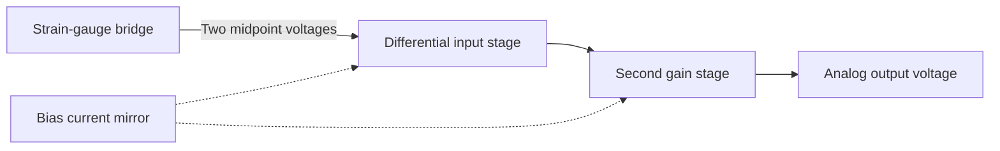

# CMOS Differential Amplifier for Strain-Gauge Bridge Readout

A transistor-level design and simulation project exploring how a low-power CMOS amplifier can read the small voltage difference produced by a strain-gauge bridge.

**Authors:** Arnold Ackom ODURO and Hanz OFOSUHENE-SINTIM  
**Institution:** JUNIA ISEN  
**Original project:** November 2026

## The application

A strain gauge changes resistance when its supporting material stretches or compresses. A Wheatstone bridge converts that change into a small differential voltage, as used in load cells for weighing and force measurement.

Our demonstration uses four nominally 350-ohm resistors with 0.8 V excitation. Both bridge midpoints sit at 0.4 V when balanced. Changing one resistance by +/-0.1% produces approximately +/-200 microvolts between the midpoints. The amplifier makes this small difference easier to measure.

The application shaped the design priorities: differential gain, common-mode rejection around a 0.4 V input bias, low quiescent power, and adequate stability with a capacitive load.

## Circuit overview

The circuit follows an eight-transistor, two-stage architecture:

- A PMOS reference mirror supplies the bias currents.
- A PMOS differential pair and NMOS current-mirror load form the first gain stage.
- An NMOS common-source stage with a PMOS active load provides further gain.
- A Miller capacitor shapes the frequency response.

The circuit was designed and evaluated in Cadence Virtuoso with Spectre and the gpdk045 design kit. The amplifier supply is 1.1 V, and the specified output load is 1 pF.

## Signal flow

The bridge produces two nearly equal midpoint voltages. The differential input stage responds to the small difference between them, and the second stage provides further amplification. The bias current mirror sets the operating currents for both stages.

This signal path connects the sensor application to the amplifier architecture. The following updates will examine each circuit block and the simulations used to evaluate it.

## Bias current mirror

### Why the amplifier needs it

The bias network establishes the currents that keep the amplifier stages operating. An ideal 5 µA reference flows through diode-connected PMOS Q8; its gate voltage also biases Q5, which supplies the differential pair, and Q7, which supplies the second stage.

A useful current source changes its output current as little as possible when its output voltage changes. We investigated this behaviour before selecting the bias-device dimensions.

### Standalone mirror comparison

We compared two nominal 1:1 PMOS mirrors with the same width-to-length ratio, `W/L = 5`, using a 5 µA reference. Both devices in each mirror used the dimensions shown below.

| Output voltage | W = 1 µm, L = 0.2 µm | W = 2 µm, L = 0.4 µm |
|---|---:|---:|
| 0.3 V | 5.80946 µA | 5.74548 µA |
| 0.5 V | 5.32111 µA | 5.32964 µA |
| 0.7 V | 4.78991 µA | 4.89015 µA |

These are three saved nominal simulation readings. PMOS current magnitudes are shown to make comparison with the reference straightforward.

Across 0.3–0.7 V, the current changed by **1.01955 µA** for the shorter devices and **0.85533 µA** for the longer devices. Using `r_out ≈ |ΔV / ΔI|` gives interval estimates of **392.33 kΩ** and **467.66 kΩ**, respectively: approximately **19.2% higher output resistance** with the longer devices.

### What we took into the complete circuit

The longer mirror was less sensitive to output-voltage changes across this interval. It also used four times the channel area, and its current at 0.5 V remained **6.59% above the 5 µA reference**. Equal aspect ratios therefore did not guarantee identical current accuracy.

In the assembled amplifier, we increased Q5 and Q8 from **2/0.4 µm to 4/0.8 µm**. Q5's simulator-reported local output resistance increased from **361.562 kΩ to 440.901 kΩ**, about **21.9%**. This separate operating-point measurement supported using longer bias devices to reduce tail-current changes under common-mode input variations.

The shared bias voltage also affects Q7 and the second-stage operating point. We will return to that interaction in the second-stage update.

## What this repository will document

The documentation will explain the device-sizing choices, standalone block tests, changes from the baseline circuit, complete-amplifier measurements, and the bridge demonstration. It will connect the saved simulation evidence to the reasoning behind each design choice.

The original circuit study is complete. We are organizing and publishing its documentation incrementally. The updates so far cover the application, architecture, signal flow and bias current mirror. The differential input stage, second gain stage, complete-amplifier results and report will follow.

## Scope and dependencies

This is a nominal schematic-simulation study. Physical layout, fabrication, input-referred noise, random mismatch, and process-corner characterization remain outside the completed work.

Cadence software, gpdk045 models, technology-library files, and virtual-machine images are external dependencies and are excluded from this repository. Reproducing transistor-level simulations requires separately authorized access to the appropriate tools and design kit.
